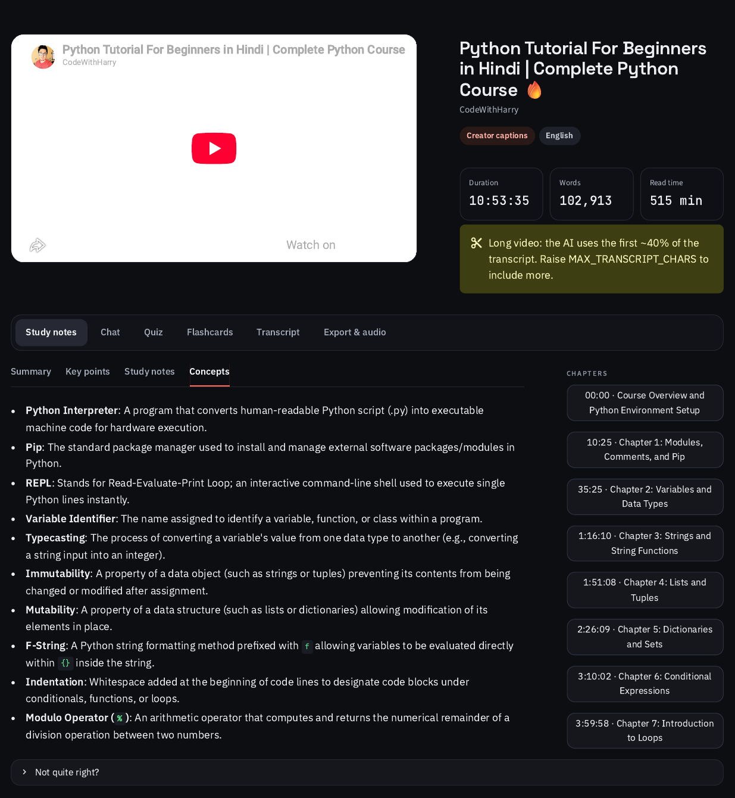
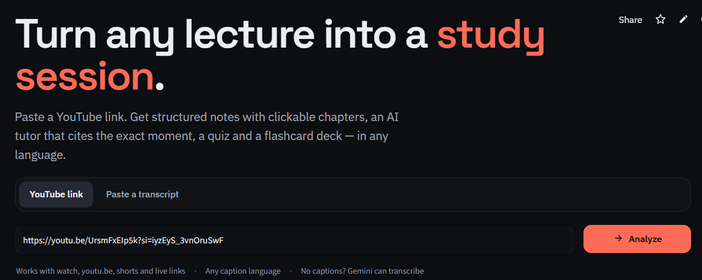
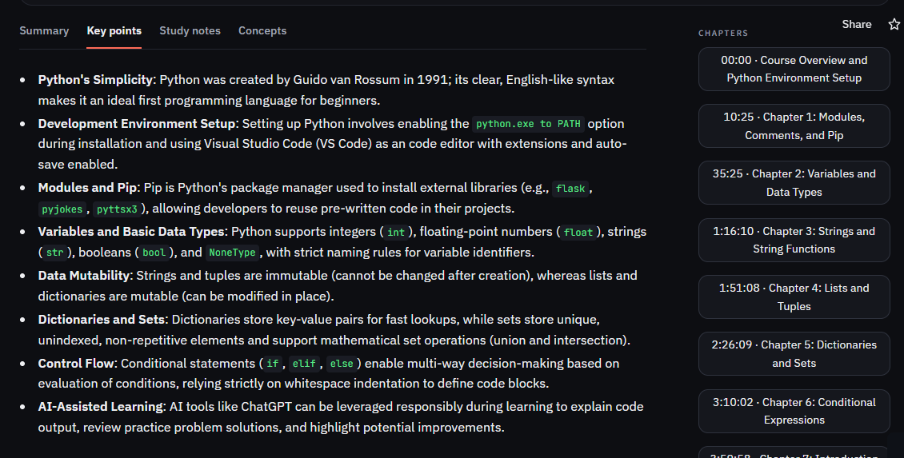
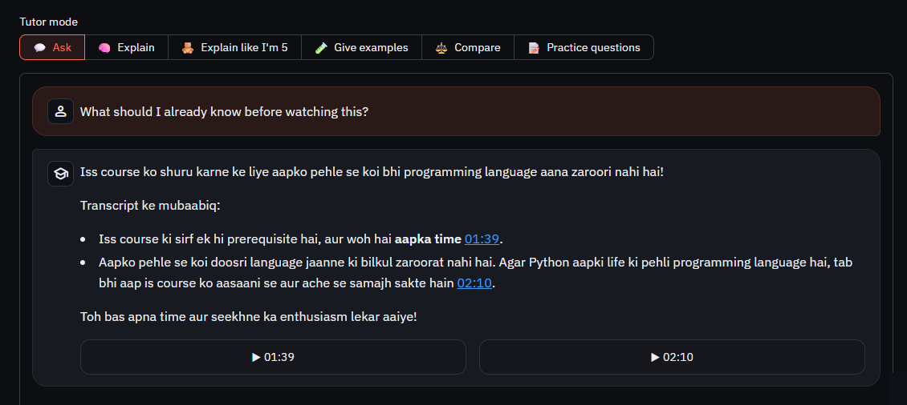
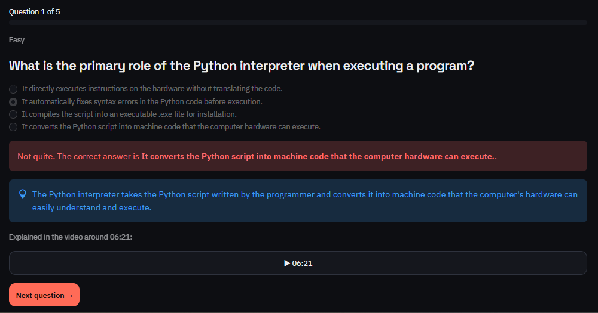
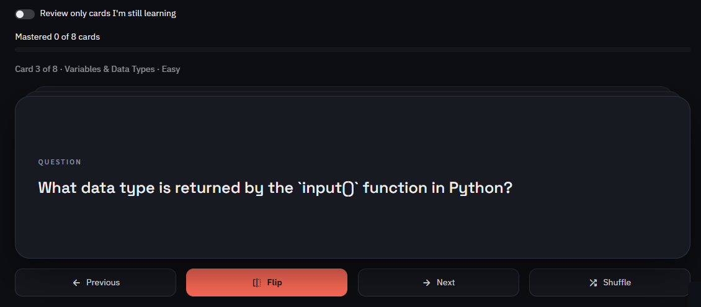

<div align="center">

# 🔎 LectureLens

### AI Video Learning Platform

**Turn any YouTube lecture into a study session.**
Structured notes with clickable chapters · an AI tutor that cites the exact moment · adaptive quizzes · flashcards · in any language.

[](https://lecturelen.streamlit.app)


[](https://github.com/Harshpoonia/lecturelens/actions/workflows/ci.yml)

<br>



</div>

---

## 📖 Overview

Watching a lecture is easy; learning from it is hard. **LectureLens** fetches a video's captions (in any language) and uses Google Gemini to turn them into material you can actually study with — notes you can navigate by chapter, a tutor you can question, and practice that adapts to what you got wrong.

> Paste a link → read the notes → ask the tutor → test yourself → export or listen.

---

## 📸 Screenshots

<p align="center"><i>Example run on a 10-hour Python course (CodeWithHarry, Hindi) — 102,913 words turned into notes, chapters, a tutor, a quiz and flashcards.</i></p>

<table>
  <tr>
    <td width="50%" valign="top"><b>Landing page</b><br></td>
    <td width="50%" valign="top"><b>Key points + clickable chapters</b><br></td>
  </tr>
  <tr>
    <td width="50%" valign="top"><b>AI tutor</b> — answers in the video's language (Hinglish here) and cites timestamps you can jump to<br></td>
    <td width="50%" valign="top"><b>Quiz</b> — instant feedback, explanation and the moment it's explained in the video<br></td>
  </tr>
  <tr>
    <td width="50%" valign="top"><b>Flashcards</b> — flip, shuffle, track mastery<br></td>
    <td width="50%" valign="top"><b>Exported study pack (PDF)</b><br>Summary, key points, notes, concepts, chapters and flashcards in one file.<br><br>📄 <a href="assets/samples/study-pack-python-course.pdf"><b>View the sample PDF</b></a></td>
  </tr>
</table>

---

## ✨ Features

| | Feature | What it does |
|---|---|---|
| 📘 | **Study notes** | Executive summary, key points, detailed notes and a glossary of concepts — generated in the video's language or one you choose |
| 🧭 | **Clickable chapters** | Auto-generated chapters and timestamps that jump the embedded player to that moment |
| 💬 | **Chat with the video** | Streaming AI tutor grounded in the transcript; every answer cites `[mm:ss]` timestamps. Modes: *Explain · ELI5 · Examples · Compare · Practice questions* |
| 📝 | **Adaptive quiz** | Choose 3–15 questions and a difficulty; instant feedback with explanations; review mistakes and **retry only what you missed** |
| 🗂️ | **Flashcards** | Flip, shuffle, mark *known / still learning*, review only weak cards, export to **Anki** |
| 📊 | **Transcript & analytics** | Word count, reading time, speaking pace, top terms, and a searchable transcript — click a line to jump there |
| 🔊 | **Listen** | Text-to-speech for the summary, notes or flashcards |
| 📤 | **Export** | Study pack as **PDF**, printable **HTML** or **Markdown**, plus quiz reports, chat logs and `.srt` captions |

### Built for real-world use
- **Works when YouTube blocks the server** — Gemini can watch and transcribe the video, or you can paste a transcript
- **Multilingual** — captions in any language; output in English, Hindi, Spanish and more
- **Bring your own key** — visitors can use their own Gemini key; a per-session cap protects the host's quota
- **Resilient AI calls** — retries with backoff, clear errors for bad keys, retired models and quota limits
- **Caching** — re-opening a video or switching tabs never re-bills the API

---

## 🛠️ Tech Stack

| Layer | Technology |
|---|---|
| Language | Python 3.10+ |
| UI | Streamlit (custom dark theme) |
| AI | Google Gemini (`google-genai`) — text, streaming and video understanding |
| Captions | `youtube-transcript-api` |
| Export / audio | `fpdf2`, `gTTS` |
| Quality | `pytest` (72 tests), `ruff`, GitHub Actions CI |
| Deploy | Streamlit Community Cloud · Docker · Render |

---

## 🏛️ Architecture

```text
 app.py ──► ui/ (sidebar · home · tabs: notes, chat, quiz, flashcards, transcript, export)
               │
               ▼
          ui/services.py  ── session wiring + caching
               │
   ┌───────────┼────────────┬──────────────┬──────────────┐
   ▼           ▼            ▼              ▼              ▼
transcript  LearningService QuizService FlashcardService ChatService
(captions)        └────────────┴───────┬──────┴──────────────┘
   │                                   ▼
   ▼                         AIService ──► Google Gemini API
youtube-transcript-api       (retries · error codes · streaming · video input)

prompts/  → all prompt templates        utils/  → parsers, text & time helpers
models/   → dataclasses                 modules/export_service, tts_service
```

- **Separation of concerns:** UI only renders; business logic lives in `modules/` with no Streamlit imports.
- **Prompts as files:** every prompt is in `prompts/`, never hard-coded.
- **One config entry point:** `config.py` reads `.env` and Streamlit secrets.

See [DECISIONS.md](DECISIONS.md) for the reasoning behind each design choice.

---

## 🚀 Getting Started

### Prerequisites
- Python 3.10 or newer
- A free Gemini API key from [Google AI Studio](https://aistudio.google.com/apikey)

### Installation

```bash
git clone https://github.com/Harshpoonia/lecturelens.git
cd lecturelens

python -m venv venv
# Windows
venv\Scripts\activate
# macOS / Linux
source venv/bin/activate

pip install -r requirements.txt
```

### Configuration

```bash
cp .env.example .env      # Windows: copy .env.example .env
```

Open `.env` and add your key:

```env
GEMINI_API_KEY=your-key-here
```

### Run

```bash
streamlit run app.py
```

Open http://localhost:8501, paste a YouTube link, and click **Analyze**.

### Tests

```bash
pip install -r requirements-dev.txt
pytest -q
ruff check .
```

---

## ☁️ Deployment

| Platform | Steps |
|---|---|
| **Streamlit Community Cloud** (recommended) | Connect the repo → main file `app.py` → add `GEMINI_API_KEY` in **Secrets** → Deploy |
| **Render** | New → Blueprint → select repo (uses `render.yaml`) |
| **Docker** | `docker build -t lecturelens . && docker run -p 8501:8501 -e GEMINI_API_KEY=... lecturelens` |

Full guide, including handling YouTube's cloud-IP blocking: [DEPLOYMENT.md](DEPLOYMENT.md)

<details>
<summary><b>Configuration options</b></summary>

| Variable | Default | Purpose |
|---|---|---|
| `GEMINI_API_KEY` | — | Server-side key (optional if visitors bring their own) |
| `GEMINI_MODEL` | `gemini-3.5-flash` | Default model |
| `ALLOW_USER_API_KEY` | `true` | Let visitors use their own key |
| `SESSION_AI_CALL_LIMIT` | `40` | AI requests per visitor session on the host key (0 = unlimited) |
| `ENABLE_GEMINI_VIDEO_FALLBACK` | `true` | Offer Gemini transcription when captions fail |
| `TRANSCRIPT_LANGUAGES` | `en,hi` | Preferred caption languages |
| `MAX_TRANSCRIPT_CHARS` | `200000` | Transcript length sent to the model |
| `CACHE_TTL_SECONDS` | `21600` | How long results stay cached |
| `WEBSHARE_PROXY_USERNAME` / `_PASSWORD` | — | Optional residential proxy for captions |

</details>

---

## 📂 Project Structure

```text
lecturelens/
├── app.py                 # Streamlit entry point
├── config.py              # settings from .env / Streamlit secrets
├── modules/               # AI service, transcript, learning/quiz/flashcard/chat services, export, TTS
├── models/                # dataclasses: transcript, notes, quiz, flashcard, chat
├── prompts/               # prompt templates
├── ui/                    # sidebar, landing page, styles, tabs/
├── utils/                 # parsers, JSON, text & time helpers
├── tests/                 # pytest suite
├── assets/                # README screenshots and a sample exported PDF
├── .streamlit/config.toml # theme
├── Dockerfile · render.yaml · packages.txt
└── DECISIONS.md · DEPLOYMENT.md · CHANGELOG.md · PROJECT_ROADMAP.md
```

---

## 🗺️ Roadmap

- [x] Notes, chapters, chat, quiz, flashcards, export, audio
- [x] Multilingual output, Gemini transcription fallback, caching, CI
- [ ] User accounts and saved progress
- [ ] Spaced-repetition scheduling for flashcards
- [ ] Long-video support with semantic search (RAG)
- [ ] Playlists and multi-video study packs

Details in [PROJECT_ROADMAP.md](PROJECT_ROADMAP.md) · version history in [CHANGELOG.md](CHANGELOG.md).

---

## 👨‍💻 Author

**Harsh Poonia** — MCA Student · AI · Machine Learning · Data Analytics

[](https://github.com/Harshpoonia)

If LectureLens helped you, consider giving it a ⭐ — it really helps!
